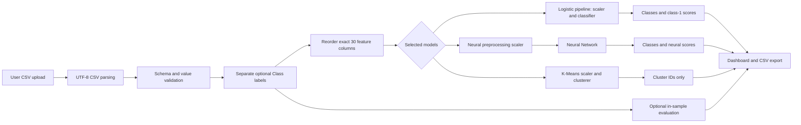
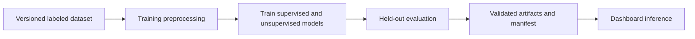
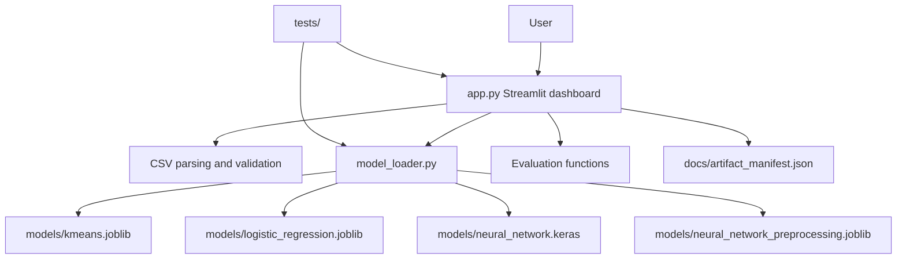

# Credit Card Fraud Detection System

> **Documentation status:** This document describes the implementation currently
> present in the repository. Dataset statistics and held-out evaluation results are
> marked **unavailable** when the source dataset or report is not present locally.
> No unverified numbers are presented as measured results.

## Table of Contents

1. [Project Overview](#1-project-overview)
2. [Problem Statement](#2-problem-statement)
3. [Project Objectives](#3-project-objectives)
4. [Dataset Explanation](#4-dataset-explanation)
5. [Complete System Workflow](#5-complete-system-workflow)
6. [Data Preprocessing](#6-data-preprocessing)
7. [Machine Learning Models](#7-machine-learning-models)
8. [Model Training](#8-model-training)
9. [Model Evaluation and Results](#9-model-evaluation-and-results)
10. [Saved Model Artifacts and Manifest](#10-saved-model-artifacts-and-manifest)
11. [Dashboard Explanation](#11-dashboard-explanation)
12. [Project Architecture](#12-project-architecture)
13. [Installation and Setup](#13-installation-and-setup)
14. [How to Use the Application](#14-how-to-use-the-application)
15. [Testing and Reliability](#15-testing-and-reliability)
16. [Limitations and Risks](#16-limitations-and-risks)
17. [Future Improvements](#17-future-improvements)
18. [Conclusion](#18-conclusion)
19. [Interview Preparation](#19-interview-preparation)
20. [References and Reproducibility](#20-references-and-reproducibility)

## 1. Project Overview

This project is a Streamlit dashboard for exploring saved machine-learning models
that score credit-card transaction records. It accepts a CSV containing the 30
model features:

```text
Time, V1, V2, V3, V4, V5, V6, V7, V8, V9, V10, V11, V12, V13, V14,
V15, V16, V17, V18, V19, V20, V21, V22, V23, V24, V25, V26, V27, V28, Amount
```

An optional `Class` column contains ground-truth labels when they are available:
`0` means legitimate and `1` means fraud. `Class` is used only for evaluation and
is never sent to a model.

The application provides two supervised fraud classifiers—Logistic Regression and
a Neural Network—and one unsupervised K-Means model. The supervised models return
classes and scores. K-Means returns a cluster ID only because its saved
cluster-to-class mapping has not been validated.

### Presentation summary

Credit-card fraud is rare, so a useful system must identify suspicious transactions
without incorrectly blocking too many legitimate customers. This project loads
pre-trained models, validates uploaded data, applies the preprocessing saved with
those models, and presents transparent predictions in a dashboard. It is a
demonstration and evaluation tool, not a certified payment-processing system.

## 2. Problem Statement

A fraudulent transaction is an unauthorized or deceptive payment. For the two
supervised models, the task is **binary classification**: choose one of two labels,
legitimate (`0`) or fraud (`1`).

Fraud detection is difficult because:

- Fraud cases are usually a small minority.
- Fraud patterns can change over time.
- False negatives allow fraud through.
- False positives inconvenience legitimate customers and investigators.
- The anonymized `V1`–`V28` features are not naturally understandable business
  fields.

The operating threshold therefore matters. A lower threshold may detect more fraud
but create more false alarms. A higher threshold may reduce false alarms but miss
more fraud. Threshold decisions should be made with validation data, not repeatedly
tuned on a final test set.

## 3. Project Objectives

### Implemented

- Load the four existing model artifacts without modifying them.
- Enforce the saved 30-feature names and order.
- Accept CSV files with or without `Class`.
- Validate numeric, finite features and binary labels.
- Keep `Class` separate from model input.
- Run Logistic Regression, Neural Network, K-Means, or a selected subset.
- Apply each saved scaler exactly once.
- Process large batches in ordered chunks.
- Preserve source row positions and original uploaded columns.
- Display supervised model scores and classes.
- Display K-Means cluster IDs without converting them to fraud labels.
- Calculate optional in-sample evaluation metrics from uploaded labels.
- Provide CSV templates, result downloads, search, filtering, model health, and
  session reset controls.
- Test artifact loading, malformed artifacts, schema validation, inference, and
  dashboard helper behavior.

### Proposed future work

- Reproduce the training pipeline from a versioned training script.
- Add an independently verified held-out dataset and report.
- Calibrate scores and select thresholds using validation data.
- Add monitoring for drift and changing fraud rates.
- Establish deployment, access-control, and operational procedures.

## 4. Dataset Explanation

### Dataset availability

No dataset file is currently included in this repository. The `.gitignore` file
explicitly excludes `data/creditcard.csv`. No `retrain_models.py`, training script,
evaluation report, or dataset provenance file is present in the inspected project.

Consequently, the following facts cannot be verified from the repository:

| Item | Status |
|---|---|
| Dataset filename and source | Not verified locally |
| Number of rows and columns | Not available |
| Legitimate/fraud counts and percentages | Not available |
| Missing-value count | Not available |
| Duplicate-row count | Not available |
| Training/test split counts | Not available |
| Training duplicate-handling implementation | Not available |

The dashboard can process an uploaded CSV, but a user must provide that file
separately. The application does not silently download or invent a dataset.

### Verified input schema

The artifacts and loader verify exactly 30 numeric model inputs:

| Column group | Meaning documented by this project |
|---|---|
| `Time` | Transaction time value supplied by the dataset |
| `V1`–`V28` | Anonymized numeric features; their business meanings are not available in this repository |
| `Amount` | Transaction amount |
| `Class` | Optional ground-truth label, `0` or `1`; never a model feature |

The loader accepts the feature columns in any CSV order, then reorders them to the
saved artifact order. Any missing or unexpected column is rejected. Values must be
numeric and finite. `Class`, when present, must be non-missing and binary.

## 5. Complete System Workflow

The verified prediction-time workflow is:



The complete training workflow cannot be documented because its training source
and reports are not present. The intended conceptual lifecycle is:



Training-time fitting and prediction-time transformation are different:

- Training fits model parameters and scalers using training data.
- Prediction loads those fitted objects and transforms new rows without fitting
  anything.
- The dashboard never retrains models and never fits a scaler on uploaded data.

## 6. Data Preprocessing

### Verified prediction-time preprocessing

1. Parse the uploaded CSV as UTF-8 with optional BOM support.
2. Check that all 30 required features exist.
3. Allow only those features plus optional `Class`.
4. Validate numeric and finite feature values.
5. Validate `Class` as binary when supplied.
6. Select features in the exact saved order.
7. Run selected models in chunks of 8,192 rows by default.

The Logistic Regression artifact is a saved scikit-learn pipeline containing a
`StandardScaler` followed by `LogisticRegression`. The pipeline applies its scaler
internally.

The Neural Network has a separate saved preprocessing artifact. The loader applies
its saved `StandardScaler` once and passes the transformed 30-column matrix to the
network.

K-Means has its own saved scaler, which is applied once before cluster prediction.

### Training-time preprocessing

Duplicate handling, train/test splitting, stratification, and fitting details
cannot be confirmed because the training code is absent. They must not be inferred
from the saved inference artifacts.

## 7. Machine Learning Models

### A. Logistic Regression

Logistic Regression is a supervised classification algorithm. It combines the
input features into a score and converts that score into a class-1 score using a
logistic function. It is often a useful baseline because it is relatively simple,
fast, and interpretable compared with a deep network.

This project stores it as:

```text
StandardScaler -> LogisticRegression
```

The artifact reports classes `[0, 1]`. The dashboard uses the class-1 output as the
fraud-class score. This score is not described as calibrated risk because no
calibration evidence is stored.

### B. Neural Network

The saved Keras archive verifies this architecture:

```text
Input(30)
Dense(64, relu)
Dropout(0.25)
Dense(32, relu)
Dropout(0.15)
Dense(1, sigmoid)
```

The input layer receives 30 scaled features. The hidden layers can learn nonlinear
relationships. The final sigmoid produces one value between 0 and 1, which the
dashboard compares with the saved threshold `0.5` to produce a class. This output
is a model score and is not claimed to be calibrated probability.

### C. K-Means Clustering

K-Means is unsupervised: it groups rows by similarity without needing fraud labels.
The saved model has two clusters and returns `kmeans_cluster`.

The artifact also contains `{0: 0, 1: 0}` as `cluster_to_class`, but there is no
original labeled training data or row-index metadata in the repository with which
to validate it. The loader intentionally ignores this mapping. K-Means is never
shown as a fraud classifier, fraud probability, supervised metric, or model ranking
entry.

## 8. Model Training

No `retrain_models.py` or equivalent training source is present in the current
project. Therefore the following cannot be confirmed:

- How the dataset was loaded.
- Whether exact duplicates were removed.
- How train/test rows were separated.
- Whether the split was random, stratified, or time-based.
- How the models were fitted.
- Which reports were generated.
- How staging and artifact promotion were performed.

The repository does contain frozen inference artifacts and a manifest. Any future
training workflow should preserve the 30-feature schema, keep `Class` out of the
features, evaluate on independent data, and regenerate the manifest only after
review and validation.

## 9. Model Evaluation and Results

### Current verified status

**Held-out evaluation is BLOCKED.** No independent labeled dataset or evaluation
report is included in the repository. The supplied figures in the documentation
request—284,807 original rows, 1,081 duplicate rows removed, 56,746 test rows, and
the listed Logistic Regression/Neural Network metrics—could not be verified against
a current report file, so they are not published as project results.

The dashboard's Model Comparison page calculates metrics only when a user uploads
valid `Class` labels and runs predictions. Those metrics are **in-sample metrics on
the uploaded file**. They are not automatically equivalent to a held-out test
evaluation.

### Metrics used by the dashboard

| Metric | Plain-language meaning |
|---|---|
| Precision | Of transactions predicted as fraud, the fraction that were actually fraud |
| Recall | Of actual fraud transactions, the fraction detected |
| F1-score | A balance of precision and recall |
| Balanced accuracy | Average recall across the legitimate and fraud classes |
| Average Precision / PR-AUC | Summary of precision-recall behavior, useful for rare positive classes |
| ROC-AUC | Ranking quality across thresholds; only shown when both classes are present |
| Confusion matrix | Counts of true negatives, false positives, false negatives, and true positives |

Accuracy alone can be misleading in fraud detection. A model could appear accurate
by predicting nearly every transaction as legitimate while missing most fraud.

The dashboard uses `zero_division=0` for precision, recall, and F1 when a class has
no predicted examples. ROC-AUC and PR-AUC are left unavailable when the uploaded
labels contain only one class. K-Means is excluded from all supervised metrics.

## 10. Saved Model Artifacts and Manifest

| File | Purpose |
|---|---|
| `models/kmeans.joblib` | Saved K-Means scaler, clusterer, schema, and unvalidated mapping |
| `models/logistic_regression.joblib` | Saved Logistic Regression pipeline and schema |
| `models/neural_network.keras` | Saved Keras network architecture and weights |
| `models/neural_network_preprocessing.joblib` | Neural Network scaler, schema, and threshold |
| `docs/artifact_manifest.json` | SHA-256 hashes, file sizes, and deployment policy |

The current manifest records these verified file sizes:

| Artifact | Size |
|---|---:|
| `kmeans.joblib` | 914,343 bytes |
| `logistic_regression.joblib` | 3,093 bytes |
| `neural_network.keras` | 79,485 bytes |
| `neural_network_preprocessing.joblib` | 2,160 bytes |

Current SHA-256 verification matches the manifest for all four files. The manifest
states that retraining requires evaluation, validation, and manifest regeneration.
It is a change-detection and deployment-integrity record, not proof that a model is
accurate.

Feature order and preprocessing must match training. Passing columns in the wrong
order can produce valid-looking but incorrect predictions, which is why the loader
checks the saved schema and scaler metadata.

## 11. Dashboard Explanation

### Overview

Shows processed-row totals, supervised predicted class counts when available, actual
fraud counts when `Class` is present, actual/predicted distributions, and model
status. Values come from the current processed dataset and saved model outputs.

### Fraud Detection

1. Upload a UTF-8 CSV.
2. Review validation feedback and the first rows.
3. Select Logistic Regression, Neural Network, K-Means, or all three.
4. Press **Run predictions**.
5. Review the results and download the CSV.

Predictions do not run automatically during upload. A spinner is shown while
inference runs. Validation errors are displayed as actionable messages.

The results preserve the original uploaded columns and add a `Source row` position
plus the selected model outputs.

### Model Comparison

When valid labels and supervised predictions are available, this page shows
precision, recall, F1, balanced accuracy, ROC-AUC, PR-AUC, and confusion matrices.
It warns that uploaded-data metrics are in-sample. If labels are absent, supervised
evaluation is unavailable.

### Transaction Explorer

Provides text search, supervised model filtering, predicted-class filtering, a
limited table for practical browsing, and a filtered CSV download. K-Means has a
cluster ID but no fraud probability.

### Single Transaction Prediction

Supports selecting a row from the latest processed dataset or entering one complete
30-feature transaction manually. The ground-truth `Class`, if present in the
selected row, is displayed separately and is not sent to inference.

### Model Health

Reports artifact presence, file size, SHA-256 comparison with the manifest, runtime
versions, feature schema, thresholds, and model limitations. Missing metadata is
shown as unavailable instead of being silently invented.

## 12. Project Architecture



Important directories and files:

- `app.py`: Streamlit pages, state management, CSV parsing, downloads, model health,
  and user-facing warnings.
- `model_loader.py`: artifact validation, feature validation, chunked inference,
  supervised evaluation, and K-Means safety rules.
- `models/`: saved inference artifacts.
- `docs/artifact_manifest.json`: artifact integrity metadata.
- `tests/test_model_compatibility.py`: model loading and schema/prediction checks.
- `tests/test_loader_hardening.py`: malformed artifacts, chunking, preprocessing,
  and safety tests.
- `tests/test_dashboard.py`: Streamlit smoke tests and dashboard helper tests.
- `requirements.txt`: pinned intended dependency versions.

## 13. Installation and Setup

From the project directory in Windows PowerShell:

```powershell
py -3.12 -m venv .venv
.\.venv\Scripts\Activate.ps1
python -m pip install --upgrade pip
pip install -r requirements.txt
python -c "import sys; print(sys.executable); print(sys.version)"
python -m pip check
```

The intended dependency pins are in `requirements.txt`. In the previously verified
global interpreter, scikit-learn was `1.4.2` while the artifacts were saved with
`1.6.1`; use the isolated environment and verify the full stack before relying on
the pins.

Run tests and compilation checks:

```powershell
python -m py_compile app.py model_loader.py
python -m pytest -q
```

Start the dashboard:

```powershell
streamlit run app.py
```

The dataset is not included. Obtain it through the approved course/project source
and place it outside the repository or upload it directly through the dashboard.
The local `data/creditcard.csv` path is ignored by `.gitignore`.

## 14. How to Use the Application

1. Activate the virtual environment.
2. Start Streamlit with `streamlit run app.py`.
3. Open the local URL shown by Streamlit.
4. Open **Fraud Detection**.
5. Upload a CSV with the exact 30 feature names. Add `Class` only when actual labels
   are available.
6. Confirm the validation message and preview.
7. Select the models to run.
8. Press **Run predictions**.
9. Read supervised classes and scores as model outputs, not guaranteed calibrated
   risk.
10. Read K-Means values as cluster IDs only.
11. Download predictions or inspect individual rows.
12. If `Class` was uploaded, use Model Comparison for in-sample diagnostic metrics.
13. Use Model Health to inspect artifact hashes and runtime information.

## 15. Testing and Reliability

The test suite checks both pure model behavior and dashboard behavior. The latest
verified result is:

```text
44 passed, 76 warnings
```

The tests cover:

- Saved artifact loading and expected object types.
- Exact feature count and feature order.
- Missing, extra, non-numeric, NaN, and infinite values.
- Optional `Class` exclusion from model input.
- Logistic and Neural Network inference.
- K-Means cluster-only output.
- Single-row and batch behavior.
- Chunked inference and source index preservation.
- Invalid thresholds and malformed artifact structures.
- Missing model files.
- CSV parsing, UTF-8 BOM handling, and stale-result invalidation.
- Dashboard page smoke tests.
- Manifest hash helpers and model-health reporting.

A passing suite demonstrates that the tested contracts work in the tested
environment. It does not prove model accuracy, data independence, production
availability, or resistance to every operational failure.

## 16. Limitations and Risks

- **Severe class imbalance:** fraud may be rare, so accuracy is insufficient.
- **False positives:** legitimate customers may be flagged and require review.
- **Threshold sensitivity:** the saved threshold is a fixed inference rule, not a
  validation-tuned operating point.
- **Dataset drift:** transaction behavior and fraud patterns can change.
- **Anonymized features:** V1–V28 cannot be explained in business terms from this
  repository.
- **Evaluation availability:** no independent held-out dataset or report is included.
- **Artifact version mismatch:** the active global environment used scikit-learn
  1.4.2 while serialized estimators report 1.6.1.
- **K-Means interpretation:** its mapping is degenerate and unvalidated; clusters
  are not fraud labels.
- **Score calibration:** no calibration data is saved, so model scores must not be
  treated as calibrated probabilities.
- **Demonstration scope:** this is not a certified real-world fraud prevention
  system and has no documented payment-network integration or operational controls.

## 17. Future Improvements

These are proposed improvements, not completed features:

1. Add a versioned training script and data provenance record.
2. Add a genuinely independent, time-aware or stratified held-out evaluation.
3. Tune thresholds on validation data using a documented business objective.
4. Add precision-recall and ROC curves with confidence intervals where appropriate.
5. Calibrate scores and validate calibration on separate data.
6. Add cross-validation and repeated-seed stability analysis.
7. Monitor feature distributions, class rates, drift, and score distributions.
8. Establish artifact promotion review and automated manifest regeneration.
9. Verify the complete pinned environment in CI.
10. Add deployment authentication, access control, logging, and secure data-retention
    procedures.

## 18. Conclusion

This project demonstrates an end-to-end inference dashboard for a difficult binary
classification problem. It combines two supervised classifiers with an unsupervised
clusterer, validates incoming CSV data, applies saved preprocessing, preserves
traceability to source rows, and exposes model limitations rather than hiding them.

The strongest verified engineering outcomes are schema enforcement, safe handling of
the optional target column, artifact validation, K-Means interpretation safety,
chunked inference, and automated dashboard tests. The main unresolved evidence gap
is independent held-out evaluation: the necessary dataset and training provenance
are not present in the repository.

## 19. Interview Preparation

### 60-second explanation

I built a Streamlit credit-card fraud detection dashboard around four saved model
artifacts. It accepts the 30 numeric transaction features and optionally a `Class`
label for evaluation. Logistic Regression and a Neural Network produce supervised
fraud classes and scores, while K-Means is presented only as an unsupervised cluster
ID because its saved class mapping is not validated. The loader enforces feature
order, applies the saved preprocessing exactly once, rejects invalid data, processes
large files in chunks, and preserves source-row traceability. The project includes
dashboard smoke tests and artifact-integrity checks. A major limitation is that an
independent held-out dataset and training provenance are not currently included, so
the dashboard's uploaded-data metrics must not be presented as generalization
performance.

### Likely interview questions

1. **Why is this an imbalanced classification problem?**  
   Fraud is usually much less common than legitimate activity, so class counts are
   uneven and accuracy can hide missed fraud.

2. **Why keep `Class` out of the features?**  
   It is the answer the model is supposed to predict. Including it would leak the
   target and produce invalid evaluation.

3. **Why use precision and recall?**  
   Recall measures how much fraud is caught; precision measures how many fraud alerts
   are correct. Both matter operationally.

4. **Why is K-Means not a fraud classifier here?**  
   K-Means learns groups without labels, and its stored cluster-to-class mapping is
   unvalidated and maps both clusters to `0`.

5. **Why must feature order be fixed?**  
   A model associates each numeric position with a trained feature. Swapping columns
   can produce plausible but wrong predictions.

6. **Why save preprocessing?**  
   The same transformation used during training must be reused during inference.
   Fitting a new scaler on uploaded rows would change the feature space.

7. **What does the Neural Network threshold mean?**  
   Its saved preprocessing artifact specifies `0.5`; scores at or above that value
   become class `1`. It is not evidence of calibration.

8. **What is the biggest evaluation limitation?**  
   The repository lacks an independent labeled test dataset and training provenance,
   so held-out generalization cannot be verified.

9. **How are invalid uploads handled?**  
   The parser and loader reject missing/extra columns, bad numeric values, non-finite
   values, empty files, and invalid binary labels with user-facing errors.

10. **What would you improve next?**  
    Add reproducible training, an independent time-aware evaluation, validation-based
    threshold selection, calibration, drift monitoring, and deployment controls.

### Technical concepts demonstrated

Binary classification, class imbalance, precision, recall, F1-score, PR-AUC,
ROC-AUC, confusion matrices, StandardScaler, preprocessing reuse, K-Means,
artifact serialization, schema validation, chunked inference, Streamlit state,
SHA-256 integrity checks, and test-driven hardening.

## 20. References and Reproducibility

### Verified project references

- [Project README](../README.md)
- [Streamlit entrypoint](../app.py)
- [Model loader](../model_loader.py)
- [Requirements](../requirements.txt)
- [Artifact manifest](artifact_manifest.json)
- [Compatibility tests](../tests/test_model_compatibility.py)
- [Loader hardening tests](../tests/test_loader_hardening.py)
- [Dashboard tests](../tests/test_dashboard.py)

### Library references

- [scikit-learn documentation](https://scikit-learn.org/stable/)
- [scikit-learn LogisticRegression](https://scikit-learn.org/stable/modules/generated/sklearn.linear_model.LogisticRegression.html)
- [scikit-learn KMeans](https://scikit-learn.org/stable/modules/generated/sklearn.cluster.KMeans.html)
- [scikit-learn StandardScaler](https://scikit-learn.org/stable/modules/generated/sklearn.preprocessing.StandardScaler.html)
- [TensorFlow Keras documentation](https://www.tensorflow.org/guide/keras)
- [Streamlit documentation](https://docs.streamlit.io/)

The original dataset source is not confirmed in this repository, so no dataset
citation is asserted. A future reproducibility package should record the source
URL/version, checksum, acquisition date, preprocessing configuration, split
strategy, random seeds, training environment, and evaluation report.

### Reproducibility boundary

Another developer can reproduce the current dashboard inference workflow by:

1. Creating the Python 3.12 virtual environment.
2. Installing `requirements.txt`.
3. Confirming `pip check`.
4. Running `pytest -q`.
5. Verifying artifact hashes against `docs/artifact_manifest.json`.
6. Starting `streamlit run app.py`.
7. Uploading an independently obtained CSV with the documented schema.

The original training run and held-out evaluation cannot be reproduced from this
repository alone because the training script, dataset, and evaluation report are
not included.
